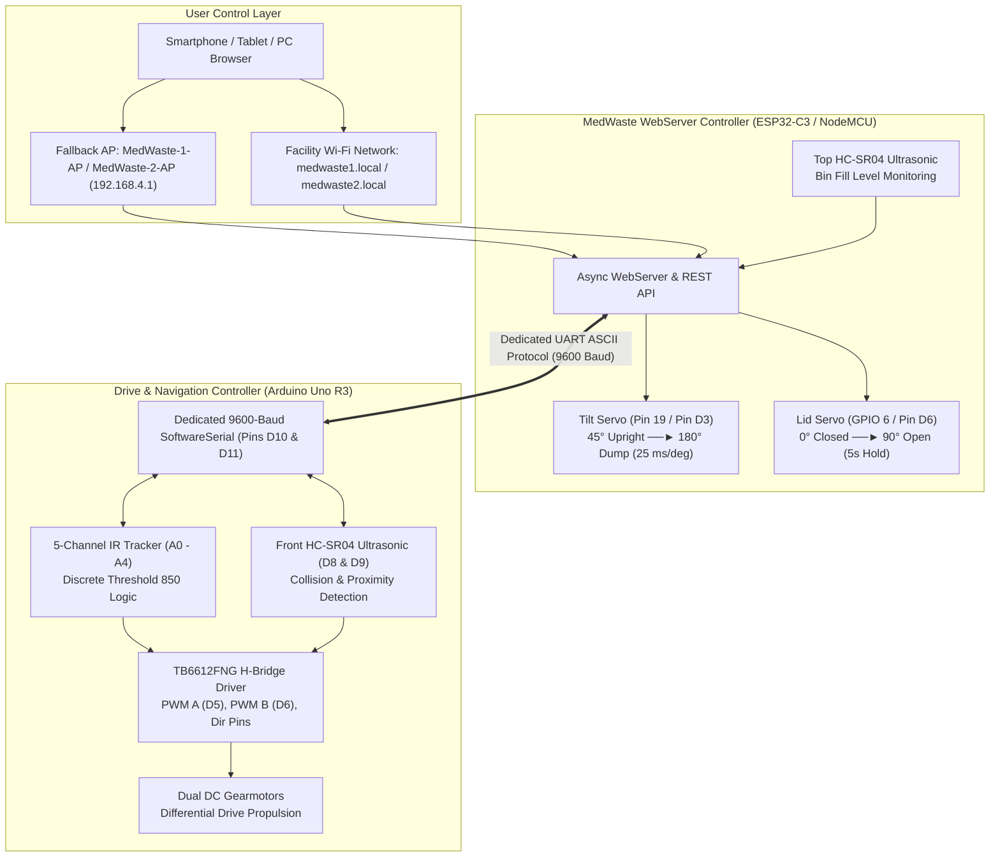
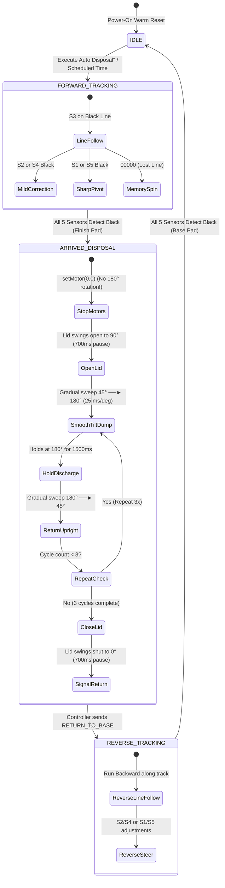

# MedWaste Bot — Autonomous Medical Waste Disposal System

[](https://www.arduino.cc/en/software)
[](https://www.espressif.com/)
[](https://nodemcu.readthedocs.io/)
[](https://store.arduino.cc/products/arduino-uno-rev3)
[](#1-arduino-uno-r3-drive--navigation-controller)
[](file:///c:/Users/Kananyan/Desktop/MED_WASTE_BOT/TROUBLESHOOTING.md)
[](file:///c:/Users/Kananyan/Desktop/MED_WASTE_BOT/SETUP_GUIDE.md)

An autonomous, touch-free medical waste collection and disposal robotic system designed for hospitals, isolation clinics, and clinical laboratories. The system integrates touchless biohazard deposition, discrete 5-channel analog infrared line tracking, dual HC-SR04 ultrasonic obstacle and fill-level sensing, and a gradual motorized biohazard bin tilt mechanism featuring forward-and-reverse autonomous navigation.

---

## 📚 Essential Documentation

| Document | Description | Direct Link |
| :--- | :--- | :--- |
| **Complete Setup Guide** | Comprehensive from-scratch guide: BOM, Arduino IDE setup, boards manager URLs, libraries, complete wiring, servo zeroing, flashing, and step-by-step testing until working. | [SETUP_GUIDE.md](file:///c:/Users/Kananyan/Desktop/MED_WASTE_BOT/SETUP_GUIDE.md) |
| **Troubleshooting Handbook** | **54 fully documented, clickable issues** spanning electrical, motor driver, servos, IR line tracking, ultrasonics, serial link, Wi-Fi, and compilation. | [TROUBLESHOOTING.md](file:///c:/Users/Kananyan/Desktop/MED_WASTE_BOT/TROUBLESHOOTING.md) |
| **Pin Connections Cheatsheet** | Pure-text pinout table for rapid breadboard and bench testing. | [PIN_CONNECTIONS.txt](file:///c:/Users/Kananyan/Desktop/MED_WASTE_BOT/PIN_CONNECTIONS.txt) |

---

## Table of Contents
1. [Key Features & System Innovations](#key-features--system-innovations)
2. [System Architecture & Data Flow](#system-architecture--data-flow)
3. [Hardware Components & Pinout Reference](#hardware-components--pinout-reference)
   * [3.1 Arduino Uno R3 (Drive & Navigation)](#31-arduino-uno-r3-drive--navigation)
   * [3.2 MedWaste Control 1 (ESP32-C3 WebServer)](#32-medwaste-control-1-esp32-c3-webserver)
   * [3.3 MedWaste Control 2 (NodeMCU ESP8266 WebServer)](#33-medwaste-control-2-nodemcu-esp8266-webserver)
   * [3.4 Power Architecture & Common Ground](#34-power-architecture--common-ground)
4. [Autonomous Mission Sequence (Forward & Reverse)](#autonomous-mission-sequence-forward--reverse)
5. [Web Dashboard Tour & Operational Capabilities](#web-dashboard-tour--operational-capabilities)
6. [Firmware Source Code Map](#firmware-source-code-map)
7. [Serial Communication Protocol (Uno ⟷ Controller)](#serial-communication-protocol-uno--controller)
8. [Troubleshooting Guide Quick-Index](#troubleshooting-guide-quick-index)

---

## Key Features & System Innovations

* **Dual-Controller Distributed Topology**:
  * **Arduino Uno R3**: Executes time-critical motor loops, 5-sensor analog IR tracking, front obstacle avoidance, and hardware deadman protection.
  * **MedWaste WebServer Controller** (ESP32-C3 or NodeMCU ESP8266): Serves a high-performance, dark-mode mobile web interface, monitors container fill volume, and drives the lid and tilt servos.
  * Both Unit 1 and Unit 2 run **100% standalone, independent web applications** with zero dependency on each other and zero master/slave hierarchy.
* **Touch-Free Proximity Lid Deposition**:
  * Healthcare workers approach within **50 cm** to trigger the lid to swing open to 90° for **5 seconds** without touching any surface.
  * Automatically locked shut if the container volume reaches 100% full ($\le 10\text{ cm}$ remaining) to prevent biohazard overflow.
* **Discrete 5-Channel Line Following Navigation**:
  * Employs high-contrast analog infrared thresholding (`#define THRESHOLD 850`).
  * Features adaptive memory-based line re-acquisition (`lastDirection = -1` for Left, `1` for Right) to automatically spin back onto track if a sharp turn is lost.
  * Auto-Stop on Finish Pad: When all 5 sensors detect black simultaneously (`S1 && S2 && S3 && S4 && S5 > 850`), the robot stops instantly.
* **Careful Gradual Servo Tilting (Pin 19 / Pin D3)**:
  * Tilts the disposal bin from **45° (Upright Standby)** to **180° (Full Dump)**.
  * Advances in **1-degree increments with a 25 ms step delay** ($\approx 3.4\text{ seconds}$ sweep). Prevents mechanical backlash, gear train stripping, and dangerous fluid splashing.
  * Sweeps 3 full discharge cycles during every automated disposal mission.
* **Momentary Hold-to-Drive Teleoperation**:
  * Intuitive D-Pad controls: touch and hold to drive; release to stop instantly.
  * Integrated **500 ms minimum tap duration** to guarantee sufficient motor torque and prevent gearbox stuttering on quick clicks.
  * Hardware **650 ms deadman watchdog** halts DC motors automatically if Wi-Fi packets drop.
* **Automatic Cold Power-On Warm Reset**:
  * Firmware pauses ~800ms upon battery switch engagement to let decoupling capacitors stabilize, then triggers a clean internal soft restart so Wi-Fi and UART initialize with 100% reliability.

---

## System Architecture & Data Flow



---

## Hardware Components & Pinout Reference

### 3.1 Arduino Uno R3 (Drive & Navigation)
Source code: [`uno_motor_control.ino`](file:///c:/Users/Kananyan/Desktop/MED_WASTE_BOT/uno_motor_control.ino)

#### TB6612FNG Dual DC Motor Driver
| Pin on TB6612FNG | Uno Connection | Description |
| :--- | :--- | :--- |
| **PWMA** | **Pin D5** | Left Motor PWM Speed Control (0–255) |
| **AIN1** | **Pin D3** | Left Motor Direction 1 |
| **AIN2** | **Pin D2** | Left Motor Direction 2 |
| **PWMB** | **Pin D6** | Right Motor PWM Speed Control (0–255) |
| **BIN1** | **Pin D4** | Right Motor Direction 1 |
| **BIN2** | **Pin D7** | Right Motor Direction 2 |
| **STBY** | **5V Rail** | Hardwired HIGH to keep H-bridge active |
| **VM** | **Battery (+) (7.4V–11.1V)** | High-current motor supply rail |
| **VCC** | **Arduino 5V** | Driver logic power |
| **GND** | **Common Ground** | Connected to Battery GND and Controller GND |

#### Front HC-SR04 Ultrasonic Sensor (Obstacle & Person Detection)
| Sensor Pin | Uno Connection | Description |
| :--- | :--- | :--- |
| **VCC** | **Arduino 5V** | 5V Power Supply |
| **TRIG** | **Pin D8** | Ultrasonic 10 µs trigger pulse |
| **ECHO** | **Pin D9** | Ultrasonic pulse echo input |
| **GND** | **Arduino GND** | Common Ground |

#### 5-Channel Analog IR Line Tracking Sensor Array
| Sensor Channel | Uno Connection | Physical Position | Description |
| :--- | :--- | :--- | :--- |
| **OUT 1** | **Pin A0** | Far Left | Detects sharp left deviation & pads |
| **OUT 2** | **Pin A1** | Mid Left | Detects mild left deviation |
| **OUT 3** | **Pin A2** | Center | Guide line reference tracker |
| **OUT 4** | **Pin A3** | Mid Right | Detects mild right deviation |
| **OUT 5** | **Pin A4** | Far Right | Detects sharp right deviation & pads |
| **VCC / GND** | **5V / GND** | — | Powers TCRT5000 array |

#### Dedicated Serial Link to Controller
| Arduino Uno Pin | ESP32-C3 Connection | NodeMCU ESP8266 Connection | Direction |
| :--- | :--- | :--- | :--- |
| **Pin D11 (ESP_TX)** | **GPIO 2 (UNO_RX)** | **Pin D5 / GPIO 14 (UNO_RX)** | Uno $\rightarrow$ Controller |
| **Pin D10 (ESP_RX)** | **GPIO 3 (UNO_TX)** | **Pin D7 / GPIO 13 (UNO_TX)** | Controller $\rightarrow$ Uno |
| **GND** | **GND** | **GND** | **CRITICAL: Shared Common Ground** |

*(Hardware Serial Pins D0/D1 remain completely free for USB programming and PC Serial Monitoring).*

---

### 3.2 MedWaste Control 1 (ESP32-C3 WebServer)
Source code: [`master_esp32s2_webserver.ino`](file:///c:/Users/Kananyan/Desktop/MED_WASTE_BOT/master_esp32s2_webserver.ino)

| Peripheral | Component Pin | ESP32-C3 Pin | Specification & Operational Notes |
| :--- | :--- | :--- | :--- |
| **Tilt Servo** | Signal (Yellow/Orange) | **GPIO 19** | **Pin 19**: 45° Upright to 180° Dump (25 ms/deg step delay) |
| **Tilt Servo** | VCC & GND | UBEC 5V/6V & GND | High-torque metal gear servo (MG996R/DS3218) |
| **Lid Servo** | Signal (Yellow/Orange) | **GPIO 6** | 0° Closed to 90° Open touchless lid actuation |
| **Lid Servo** | VCC & GND | UBEC 5V/6V & GND | Micro servo (SG90/MG90S) |
| **Top Depth Ultrasonic** | TRIG | **GPIO 4** | Container depth trigger pulse |
| **Top Depth Ultrasonic** | ECHO | **GPIO 5** | Pulse input via 1k:2k voltage divider to 3.3V |
| **Uno UART Link** | UNO_RX | **GPIO 2** | Hardware `Serial1` RX (from Uno D11) |
| **Uno UART Link** | UNO_TX | **GPIO 3** | Hardware `Serial1` TX (to Uno D10) |
| **Power Input** | VIN & GND | UBEC 5V & GND | Powers ESP32-C3 onboard 3.3V LDO regulator |

---

### 3.3 MedWaste Control 2 (NodeMCU ESP8266 WebServer)
Source code: [`slave_esp32s2_client.ino`](file:///c:/Users/Kananyan/Desktop/MED_WASTE_BOT/slave_esp32s2_client.ino)

All pins are mapped to boot-safe pins across D0–D7 to ensure reliable boot-up:

| Peripheral | NodeMCU Pin | GPIO | Specification & Operational Notes |
| :--- | :--- | :---: | :--- |
| **Tilt Servo** | **Pin D3** | GPIO 0 | **Pin D3**: 45° Upright to 180° Dump (25 ms/deg step delay) |
| **Tilt Servo** | UBEC 5V/6V & GND | — | High-torque metal gear servo |
| **Lid Servo** | **Pin D6** | GPIO 12 | 0° Closed to 90° Open touchless lid actuation |
| **Lid Servo** | UBEC 5V/6V & GND | — | Micro servo |
| **Top Depth Ultrasonic** | **Pin D1** | GPIO 5 | Container depth trigger pulse |
| **Top Depth Ultrasonic** | **Pin D2** | GPIO 4 | Pulse input via 1k:2k voltage divider to 3.3V |
| **Uno UART Link** | **Pin D5** | GPIO 14 | `SoftwareSerial` RX (from Uno D11) |
| **Uno UART Link** | **Pin D7** | GPIO 13 | `SoftwareSerial` TX (to Uno D10) |
| **Power Input** | **VIN / VU** | — | Powers NodeMCU onboard 3.3V regulator |

---

### 3.4 Power Architecture & Common Ground

```
                [ 2S / 3S Li-ion Battery (7.4V - 11.1V) ]
                                    │
                               [ Switch ]
                                    │
                  ┌─────────────────┴─────────────────┐
                  ▼                                   ▼
          [ TB6612FNG VM ]                   [ UBEC 5V/6V 3A ]
       (High-Current DC Motors)              (Regulated Logic & Servos)
                  │                                   │
                  │                      ┌────────────┴────────────┐
                  │                      ▼                         ▼
             [ DC Motors ]       [ Tilt & Lid Servos ]      [ Microcontrollers ]
                  │                      │                         │
                  └──────────────────────┼─────────────────────────┘
                                         ▼
                             [ COMMON GROUND BUS (GND) ]
```

> [!IMPORTANT]
> **COMMON GROUND RULE**: Uno GND, Controller GND, Motor Driver GND, UBEC GND, and Battery GND **MUST** be connected together. Floating grounds cause serial packet loss, sensor spikes, and servo jitter.

---

## Autonomous Mission Sequence (Forward & Reverse)



---

## Web Dashboard Tour & Operational Capabilities

The mobile-optimized dark-mode web dashboard is accessible from any phone or computer browser:

```
┌────────────────────────────────────────────────────────────────────────┐
│  🏥 MEDWASTE BOT — CONTROL CENTER                           [● LIVE]   │
│  Robot State: IDLE      Uno Link: CONNECTED       Fill Level: 28%      │
├────────────────────────────────────────────────────────────────────────┤
│  ⚡ QUICK ACTIONS                                                      │
│  [ 🚀 Execute Auto Disposal ]   [ ⏹ Emergency STOP ]   [ 📭 Open Lid ]  │
├────────────────────────────────────────────────────────────────────────┤
│  🎮 MANUAL TELEOPERATION (Hold-to-Drive with 500ms Tap Floor)          │
│                      [ ▲ FORWARD ]                                     │
│         [ ◄ LEFT ]     [ ■ STOP ]     [ ► RIGHT ]                      │
│                      [ ▼ REVERSE ]                                     │
├────────────────────────────────────────────────────────────────────────┤
│  🦾 SERVO TILT CONTROL (Pin 19 / Pin D3)                               │
│  Current: 45° (Upright)      Speed: 25 ms/deg (Careful Gradual Tilt)   │
│  [ 45° Upright ]   [ 90° Half ]   [ 135° Tilt ]   [ 180° Full Dump ]   │
├────────────────────────────────────────────────────────────────────────┤
│  🎚️ LIVE 5-CHANNEL IR LINE SENSOR VISUALIZER (Threshold: 850)         │
│  S1 [▓▓░░░░░░░░] 120   S2 [▓▓░░░░░░░░] 135   S3 [▓▓▓▓▓▓▓▓▓▓] 940 (LINE)│
│  S4 [▓▓░░░░░░░░] 140   S5 [▓▓░░░░░░░░] 115                             │
│  [ ⬛ Calibrate BLACK Pad ]         [ ➖ Calibrate Guide LINE ]        │
├────────────────────────────────────────────────────────────────────────┤
│  💻 SERIAL TELEMETRY STREAM & LOGS                                     │
│  STATUS,150,120,135,940,140,115,STOPPED,0,IDLE,85                      │
└────────────────────────────────────────────────────────────────────────┘
```

1. **Touchless Hands-Free Proximity**: When parked in IDLE, stepping within 50 cm of the front sensor swings the lid open to 90° for 5 seconds.
2. **Momentary Hold-to-Drive**: Touch and hold any arrow button to drive smoothly; release to brake immediately. Quick taps execute a safe 500ms pulse step.
3. **Careful Gradual Tilting**: Command the tilt servo to 45°, 90°, 135°, or 180°. The firmware advances the servo 1 degree at a time at 25 ms/deg.
4. **Sensor Auto-Calibration**: One-click calibration routines for black landing pads and the black guide line save optimized thresholds directly to Flash memory.
5. **Scheduled Auto-Disposal**: Set a daily mission time (e.g. `23:00`) for fully autonomous night-time sterilization cycles.

---

## Firmware Source Code Map

All project source files are maintained in the workspace and synchronized to your local Arduino IDE sketchbook:

| Workspace File | Arduino IDE Sketchbook Copy | Target Board | Primary Role |
| :--- | :--- | :--- | :--- |
| [`uno_motor_control.ino`](file:///c:/Users/Kananyan/Desktop/MED_WASTE_BOT/uno_motor_control.ino) | `Documents\Arduino\MOTOR_CTRL\MOTOR_CTRL.ino` | Arduino Uno R3 | TB6612FNG H-bridge, 5-Ch IR array, front ultrasonic, SoftwareSerial |
| [`master_esp32s2_webserver.ino`](file:///c:/Users/Kananyan/Desktop/MED_WASTE_BOT/master_esp32s2_webserver.ino) | `Documents\Arduino\MASTER\MASTER.ino` | ESP32-C3 SuperMini | WebServer 1, Lid Servo (GPIO 6), Tilt Servo (Pin 19), Top ultrasonic |
| [`slave_esp32s2_client.ino`](file:///c:/Users/Kananyan/Desktop/MED_WASTE_BOT/slave_esp32s2_client.ino) | `Documents\Arduino\Slave\Slave.ino` | NodeMCU ESP8266 | WebServer 2, Lid Servo (Pin D6), Tilt Servo (Pin D3), Top ultrasonic |

---

## Serial Communication Protocol (Uno ⟷ Controller)

Communication operates over dedicated UART (Uno pins D10/D11) at **9600 baud, 8N1** using clean ASCII packets:

### Telemetry Stream (Uno $\rightarrow$ Controller, every 500 ms)
```text
STATUS,<speed>,<S1>,<S2>,<S3>,<S4>,<S5>,<motor_state>,<obstacle_flag>,<robot_state>,<front_dist>
```
*Example:* `STATUS,150,110,125,920,130,105,FORWARD,0,MOVING,92`

### Command & Event Packets
| Packet String | Direction | Purpose & Action |
| :--- | :--- | :--- |
| `OPEN_LID` | Uno $\rightarrow$ Controller | Person detected within 50 cm while idle; trigger 5-second lid open cycle. |
| `ARRIVED_DISPOSAL` | Uno $\rightarrow$ Controller | All 5 sensors detected black finish pad; stop motors and execute dump. |
| `ARRIVED_BASE` | Uno $\rightarrow$ Controller | All 5 sensors detected black base pad in reverse; halt and park in IDLE. |
| `MOVE_TO_DISPOSAL` | Controller $\rightarrow$ Uno | Engage forward line tracking toward disposal station. |
| `RETURN_TO_BASE` | Controller $\rightarrow$ Uno | Engage reverse line tracking backward toward base station. |
| `BIN_FULL,1` | Controller $\rightarrow$ Uno | Bin capacity $\le 10\text{ cm}$; lock proximity lid opening shut. |
| `BIN_FULL,0` | Controller $\rightarrow$ Uno | Bin capacity clear; restore normal proximity lid operation. |
| `MAN_FWD` / `MAN_STOP` | Controller $\rightarrow$ Uno | Manual teleoperation command with hold keep-alive. |
| `SET,<spd>,<obs>` | Controller $\rightarrow$ Uno | Update base speed (0–255) and obstacle threshold (cm). |
| `CAL,<b>,<l>,<spin>,<p>`| Controller $\rightarrow$ Uno | Sync black pad, line threshold, spin duration, and person range. |

---

## Troubleshooting Guide Quick-Index

For full diagnostic workflows and concrete hardware/software solutions, consult **[TROUBLESHOOTING.md](file:///c:/Users/Kananyan/Desktop/MED_WASTE_BOT/TROUBLESHOOTING.md)**:

* **[1. Power & Electrical Distribution](file:///c:/Users/Kananyan/Desktop/MED_WASTE_BOT/TROUBLESHOOTING.md#1-power--electrical-distribution)** (Issues 1–7): Brownouts, servo jitter, ESP32 reset during dump, TB6612 heating, common ground loops.
* **[2. TB6612FNG Driver & DC Motors](file:///c:/Users/Kananyan/Desktop/MED_WASTE_BOT/TROUBLESHOOTING.md#2-motor-driver-tb6612fng--dc-motors)** (Issues 8–15): No movement on click, motors running backward, veering, PWM whine, tap vs hold.
* **[3. Servos & Tilting Mechanism](file:///c:/Users/Kananyan/Desktop/MED_WASTE_BOT/TROUBLESHOOTING.md#3-servos-lid-servo--tilt-servo-pin-19--pin-d3)** (Issues 16–23): Incomplete 45°/180° travel, rapid snapping vs gradual 25ms delay, mechanical stall binding, ESP32Servo conflicts.
* **[4. 5-Channel IR Line Following](file:///c:/Users/Kananyan/Desktop/MED_WASTE_BOT/TROUBLESHOOTING.md#4-line-following--5-channel-ir-tracking-array)** (Issues 24–31): Spinning in circles, sensor array reading 0 or 1023, finish line overshoot, hunting oscillations, reverse tracking steering.
* **[5. Ultrasonic Sensors & Fill Depth](file:///c:/Users/Kananyan/Desktop/MED_WASTE_BOT/TROUBLESHOOTING.md#5-ultrasonic-sensors-front-obstacle--top-bin-depth)** (Issues 32–37): False obstacle braking, pulseIn timing blocks, bin full lockout prematurely tripping.
* **[6. Serial Communication Link](file:///c:/Users/Kananyan/Desktop/MED_WASTE_BOT/TROUBLESHOOTING.md#6-serial-communication-uno--esp32--nodemcu)** (Issues 38–41): "Uno Disconnected" badge, garbled ASCII telemetry, manual command latency.
* **[7. Wi-Fi, Hotspots & Web Dashboard](file:///c:/Users/Kananyan/Desktop/MED_WASTE_BOT/TROUBLESHOOTING.md#7-wi-fi-web-dashboard--network)** (Issues 42–48): Hotspot dropouts, mDNS .local resolution on Windows, dashboard cache refreshing.
* **[8. Arduino IDE Compilation & Uploading](file:///c:/Users/Kananyan/Desktop/MED_WASTE_BOT/TROUBLESHOOTING.md#8-arduino-ide-compilation--flashing)** (Issues 49–54): Undefined `getDistance()`, `TILT_STEPS` scope errors, COM port busy, ESP32-C3 CDC flash failures.

---

## Getting Started

Ready to assemble and power up? Head straight to the **[Complete Setup Guide (`SETUP_GUIDE.md`)](file:///c:/Users/Kananyan/Desktop/MED_WASTE_BOT/SETUP_GUIDE.md)** for step-by-step instructions from unboxing to your first autonomous mission!
